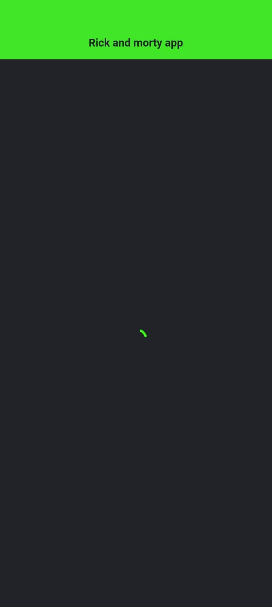
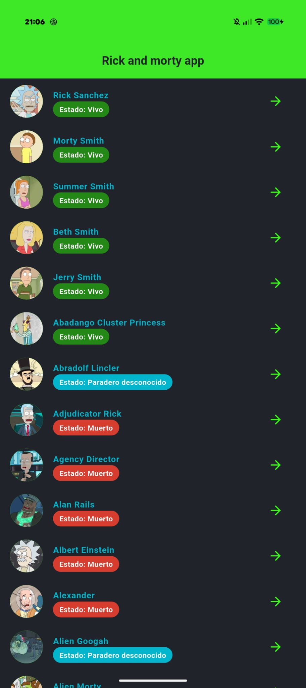
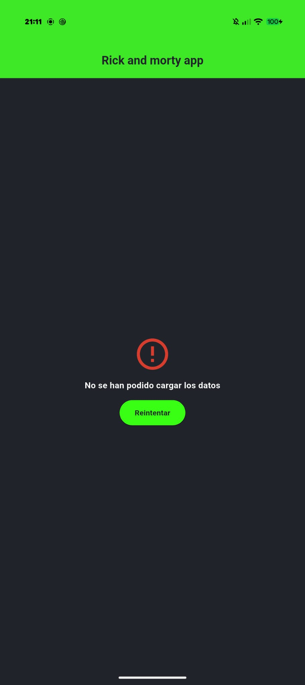

# Práctica UD02 · Rick and Morty App

Aplicación en Flutter de una sola pantalla que consume la API pública de **Rick and Morty** (`https://rickandmortyapi.com/api/character`), transforma el JSON mediante el modelo `Personaje` (`fromJson`) y gestiona los tres estados de red (`Cargando`, `Con datos` y `Error`).

📦 **Código fuente (`lib/`):** [practica.zip](./practica.zip)

---

## 1. Organización del Proyecto

```text
lib/
├── main.dart
├── models/
│   └── personajes_model.dart        ← Modelo con fromJson
├── services/
│   └── personaje_service.dart       ← Petición HTTP con control de statusCode
└── presentation/
    ├── screens/
    │   └── home_future_screen.dart  ← Pantalla principal (initState + 3 estados)
    └── widgets/
        └── pinta_personajes.dart    ← Widget propio extraído (lista y detalle)
```

---

## 2. Widgets del Catálogo Utilizados (10 widgets)

Se han utilizado **10 widgets distintos** del catálogo de la unidad (excluyendo `MaterialApp` y `Scaffold`):

| # | Widget | Uso en la aplicación |
| :-: | :--- | :--- |
| **1** | **`AppBar`** | Barra superior con el título de la app en verde portal fluorescente. |
| **2** | **`Text`** | Nombres de personajes, género, especie, estado y mensajes de error. |
| **3** | **`Icon`** | Iconos de navegación (`arrow_forward`, `arrow_back`) y alerta (`error_outline`). |
| **4** | **`IconButton`** | Botones para ver el detalle de un personaje y para regresar al listado. |
| **5** | **`CircleAvatar`** | Fotografías circulares de los personajes tanto en la lista como en el detalle. |
| **6** | **`Container`** | Etiquetas redondeadas (`BoxDecoration`) que cambian de color según el estado del personaje. |
| **7** | **`Row`** | Distribución horizontal para las etiquetas de estado y los datos de especie/estado. |
| **8** | **`Column`** | Distribución vertical para la ficha de detalle del personaje y la vista de error. |
| **9** | **`SizedBox`** | Separación vertical y horizontal entre elementos de la interfaz. |
| **10** | **`ElevatedButton`** | Botón de **«Reintentar»** en el estado de error para volver a lanzar la petición con `setState`. |

---

## 3. Los Tres Estados de la Pantalla

### ⏳ A. Estado Cargando (`CircularProgressIndicator`)
Se muestra mientras se espera la respuesta de la petición lanzada en `initState()`:



---

### ✅ B. Estado Con Datos (Listado de Personajes)
Muestra la lista de personajes con su foto en `CircleAvatar`, nombre y estado coloreado:



---

### ❌ C. Estado de Error y Reintento
Se muestra cuando falla la conexión o el `statusCode` es distinto de `200`, incluyendo el mensaje de error y el botón **Reintentar**:



---

## 4. Vídeo de Funcionamiento

Demostración de la aplicación en funcionamiento (carga, listado, vista de detalle de personaje y navegación):

<video src="fotos/videoFuncionamiento.mp4" controls width="360"></video>
